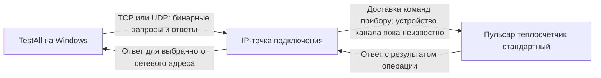

# Как TestAll записывает показания в «Пульсар теплосчетчик стандартный»

Исследовано 31 октября 2026 года по двум предоставленным файлам. Уточнения пользователя: подключение по IP; название выбранного прибора — «Пульсар теплосчетчик стандартный».

## Главный вывод

В предоставленной сборке TestAll есть именно этот прибор: внутренний идентификатор драйвера **420**. Для него программа поддерживает запись значений накопленного объёма и энергии. В рассмотренном пути первоначальные показания задаются изменением текущих накопленных значений и отправкой команды записи соответствующего канала.

Подтверждена поддержка операции программой. Разрешит ли её конкретный физический прибор, из установщика определить нельзя: драйвер обрабатывает в том числе ответ о блокировке записи. Доступ к вашему счётчику, его прошивке и текущим настройкам не проверялся.

## Соединение по IP и адрес прибора

Здесь есть два разных адреса:

- **IP и порт** определяют точку сетевого подключения.
- **Сетевой адрес счётчика** определяет прибор внутри протокола «Пульсар». По руководству, по умолчанию это заводской номер. Фактическое значение может быть изменено.

Руководство описывает TCP Client, TCP Server, TCP Server с ID и UDP Client. Одного уточнения «по IP» недостаточно, чтобы установить используемый у вас режим.

Для TCP Client TestAll сам открывает соединение к заданным IP и порту. Для TCP Server программа слушает локальный порт и ожидает входящее соединение от оборудования. Роли программы и оборудования должны быть противоположными. В режиме Server с ID дополнительно выбирается ID модема; это отдельный идентификатор, не сетевой адрес счётчика.

IP может принадлежать самому оборудованию связи с прибором либо внешнему преобразователю/модему. Реальная схема на вашем объекте пока неизвестна.



В исследованном TCP Client код использует `System.Net.Sockets.TcpClient.Connect`, `GetStream` и `Stream.Write/Read`: он передаёт байты протокола прибора через TCP. На этом пути TLS-обёртка не обнаружена; наличие VPN или другого защищённого транспорта на объекте не проверялось.

## Параметры именно вашей модели

Источник — запись `<D N="Пульсар теплосчетчик стандартный" I="420" S="128">` в `scripts/DeviceList.xml` из установщика.

| Поле TestAll | Обозначение драйвера | Смысл |
|---|---|---|
| Объём, прямой [м3] | `K1.F32` | Накопленный прямой объём |
| Объём, реверсивный [м3] | `K2.F32` | Накопленный обратный объём |
| Энергия, тепло | `K5.F32` | Накопленная энергия тепла |
| Энергия, холод | `K6.F32` | Накопленная энергия холода |
| Время нормальной работы [ч] | `K7.U32` | Счётчик времени |
| Импульсный вход 1–4 [м3] | `K9.F32`–`K12.F32` | Значения импульсных входов |
| Версия ПО | `__VERSION_INTERNAL` | Версия устройства |
| Сетевой адрес | `P0001.U32` | Адрес в протоколе прибора |
| Заводской номер | `P0003.U32` | Отдельный параметр заводского номера |
| [Энергия] Единицы измерения энергии | `P0171.U8.BIT0-3` | Настройка единиц энергии |
| Уровень доступа | `PE004.U8` | Сервисный параметр доступа |
| Пароль (старый \| новый) | `__PASSWORD` | Операция с паролем |

`K` обозначает канал, число после него — его номер, `F32` — 32-битное число с плавающей точкой. Для энергии нельзя автоматически принять Гкал: в определении этих полей единицы не указаны, а единицы энергии задаются отдельным параметром прибора.

Первые четыре строки имеют маску поддержки `S=143`. В коде флаг `ReadOnlyParametr` равен 256; этот флаг у них отсутствует. При подготовке записи TestAll исключает строки с флагом только чтения. Таким образом, эти четыре поля допускаются к записи интерфейсом программы. Это не доказывает разрешение записи прошивкой прибора.

У других теплосчётчиков «Пульсар» нумерация отличается. В частности, `K7` как энергия из примеров ультразвуковых моделей нельзя переносить на «стандартный».

## Что происходит при нажатии «Запись»

1. Обработчик проверяет заполненный сетевой адрес.
2. Собирает **все отмеченные** строки активной таблицы, которые не помечены только для чтения, и берёт введённые значения. Запись не ограничена строкой, в которой стоит курсор.
3. Выбирает драйвер по типу прибора. Для внутреннего ID 420 фабрика создаёт `HeatmeterStandart`, использующий общую реализацию `PulsarM` в `DeviceCPPExtract.dll`.
4. Для `K5.F32`, например, разбирает номер канала 5 и преобразует введённое значение в Float32.
5. Формирует маску выбранного канала. Для канала 5 это бит 4, то есть `0x10`.
6. `WriteChannel` отправляет команду **0x03** через `RequestPulsar`. Для параметров вида `P…` используется другой путь — `WriteParameter`, а не запись канала.
7. Получает ответ, проверяет его и переводит результат в отображаемое «качество». При успешном ответе `WriteChannel` дополнительно проверяет возвращённую маску канала.

Схема пакета общего протокола:

```text
адрес прибора, 4 байта
код команды, 1 байт
полная длина пакета, 1 байт
данные команды
идентификатор запроса, 2 байта
CRC, 2 байта
```

Для обычной записи одного канала Float32 данные состоят из маски канала и значения. Драйвер формирует маску на 32 либо 64 канала в зависимости от своего режима. Для окончательного воспроизведения конкретного сеанса нужен его лог; готовая команда записи вашему прибору в ходе анализа не формировалась и не отправлялась.

Адрес кодируется четырьмя байтами по парам цифр: например, номер `5296725` из руководства передаётся как `05 29 67 25`. CRC использует алгоритм CRC-16 с начальным значением `0xFFFF` и полиномом `0xA001`, младший байт передаётся первым. Совпадение алгоритма CRC с Modbus само по себе не меняет протокол пакетов: здесь исследован драйвер «Пульсар».

## Ограничения и результат записи

Общий обработчик ответов `PulsarM.FillQualityByResponseCode` различает, в частности:

| Ответ протокола | Название в драйвере | Значение |
|---|---|---|
| 0 | `ERROR_CODE_SUCCESS` | Успешный ответ, качество 192 |
| 5 | `ERROR_CODE_LOCKED` | Прибор сообщил о блокировке |
| 6 | `ERROR_CODE_RANGE` | Значение вне допустимого диапазона |
| 128 | `ERROR_CODE_NO_ANSWER` | Нет пригодного ответа, качество 12 |

В XML «стандартного» присутствуют пароль и сервисный уровень доступа, но не указано, какой уровень необходим для изменения энергии/объёма и как он связан с аппаратной защитой конкретной прошивки. Из этих файлов нельзя сделать вывод, что достаточно одного пароля или что запись всегда возможна дистанционно.

В рассмотренном обработчике успешной записи программа возвращает введённое значение и качество результата. Это **не независимое повторное чтение накопителя**. Подтверждать сохранение показаний следует отдельной операцией чтения после записи.

Два поля «Запись разрешена аппаратно» и «Запись разрешена программно», показанные в старом руководстве для ультразвукового счётчика, не следует автоматически переносить на вашу модель. В XML ID 420 соответствующих двух строк нет.

## Как проверить фактическую схему без изменения показаний

1. Посмотреть выбранный тип соединения в TestAll и его параметры: TCP Client/Server/Server с ID либо UDP Client. Для Client нужны IP и порт точки назначения; для Server — локальный порт и, при соответствующем режиме, ID.
2. Установить соединение и считать сетевой адрес, заводской номер и версию ПО прибора. Успешное TCP-соединение само по себе ещё не означает успешного обращения к счётчику.
3. Прочитать текущие объём и энергию, уточнить единицы энергии.
4. Сохранить «Лог» и «Результаты»: руководство описывает сохранение через правую кнопку мыши. В логе красным показаны запросы, синим — ответы.

Эти данные позволят проверить точный обмен вашей прошивки. Если затем потребуется штатная установка первоначальных показаний, перед записью необходимо оставить отмеченными только нужные изменяемые строки, а после — прочитать их заново. Изменение уровня доступа или пароля в этот проверочный сценарий не входит.

## Проверенные источники и воспроизводимость

**PDF:** `Руководство TestAll.pdf`, 20 физических страниц. На обложке указан 2023 год; метаданные PDF датированы 19.02.2024. На скриншотах TestAll 2.66. TCP описан на физических страницах 5–8, UDP — 9–10, Server с ID — 10–11, выбор адреса и типа — 11–14, запись и лог — 15–19, качества — 20. Номера в оглавлении частично расходятся с физическими страницами.

**Установщик:** `testall_public_setup_net48_23.07.2026.zip`. Содержит Inno Setup EXE, статически распакованный в рабочую папку сессии. Извлечены .NET-сборки, C++/CLI-драйверы и XML-каталог параметров. Файлы программы не запускались.

Основные точки проверки в сборках:

- `TestAll_Terminal.exe`: `fmTerminal.PrepeaParamVals` (токен `06000017`), `bWriteCurrent_Click` (`0600001C`), `bWriteConfig_Click` (`0600001D`).
- `DeviceWork.dll`: `DeviceStructure.MaskSupportData..cctor` (`060000E3`) — флаг только чтения 256.
- `DeviceTools.dll`: `DeviceWork.ThreadRead.StartWrite` (`06000086`) — выбор и запуск драйвера записи.
- `x86/DeviceCPPExtract.dll`: `DeviceCPPExtract..ctor` (`0600118F`), ветка для ID 420, IL `0x4F22` — создание `HeatmeterStandart`.
- Там же: `PulsarM.SetParam` (`060007D0`), `SetParams` (`060007D1`), `WriteChannel` (`060007C5`), `RequestPulsar` (`060007C4`), `EncodeNumber` (`060007A0`), `FillQualityByResponseCode` (`060007BA`), `Pulsar_CRC` (`06000B07`).
- `SerialTepl.dll`: `SerialTCPClient.Connect` (`06000284`), `ReadStream` (`06000286`), `WriteStream` (`06000287`).

Протокольный код подробно проверен в варианте x86; эквивалентность всего x64-варианта отдельно не устанавливалась.

Дополнительно без сети проверена CRC двух запросов со скриншота руководства: `05 29 67 25 04 0A AC 00 21 14` и `05 29 67 25 0A 0C 02 00 AD 00 CD 09`. Расчёт по таблице, извлечённой из `DeviceCPPExtract.dll`, и независимый побитовый расчёт дали одинаковые значения, совпавшие с пакетами: `0x1421` и `0x09CD` соответственно. Это проверка структуры протокола на примерах руководства, не проверка связи с вашим прибором.

SHA-256 исходных файлов:

```text
Руководство TestAll.pdf
6b873367c5c53c2dfbc1d28f9fef236fb956fb3bd7ad28df220eae49d4b5a680

testall_public_setup_net48_23.07.2026.zip
efd76fd18fe0f1fe99bae0585ea1b0e566dae98e310137a2beebc34dd15a6b28

Извлечённый scripts/DeviceList.xml
22bd64544cfa8967f0efc7c0182560bf91d9092cbe4b1612096f6174c58229d7

Извлечённый x86/DeviceCPPExtract.dll
eb0263250fe1997f96316d377cd5d1b2d88b00309bccfccbcd33d640c7c9a7f3
```

Исходные ZIP и PDF не изменялись. Подключения к счётчикам и записи параметров не выполнялись. Пользовательский результат — этот отчёт; распаковка, извлечённый текст, изображения страниц, локальные библиотеки анализа и разбор IL сохранены как промежуточные файлы в `work/`.
